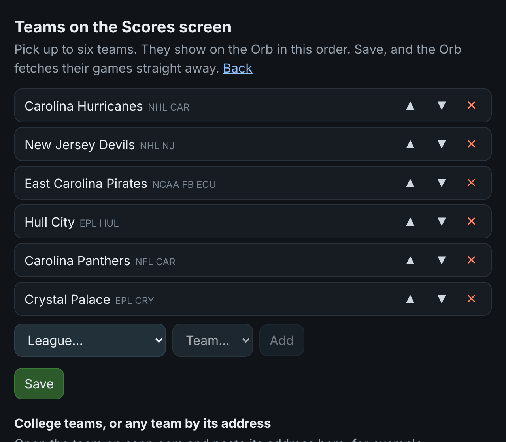

# The Orb OS

> **Orb-os-Sports** is a fork of Zion Brock's Orb firmware
> ([Ziplock78/orb-firmware](https://github.com/Ziplock78/orb-firmware)), version 2.17.01, with one
> addition: a **Scores** screen for the sports teams you follow (NFL, NHL, NBA, MLB, WNBA, college,
> and football: MLS, the Premier League and the big European leagues). Everything else is Zion's firmware, unchanged. See **[docs/SPORTS.md](docs/SPORTS.md)**
> for the Scores screen and how to pick your teams.
>
> **Installing:** download the firmware from this repository's
> [Releases](https://github.com/digidigs2/Orb-os-Sports/releases) page (see
> [Flashing a release](#flashing-a-release) below), or build and flash it yourself with
> PlatformIO: `pio run -e esp32-s3-amoled-175 -t upload` (the first build downloads the tools,
> 5–15 minutes). Orb Studio's *firmware update* button would replace this build with Zion's
> official one; themes from Orb Studio work as normal.
>
> The Orb, Orb Studio and The Orb OS are Zion Brock's work; this fork only adds the Scores
> screen. Licensed MIT like the original: see [LICENSE](LICENSE) and [NOTICE](NOTICE).


## Choosing your teams

The Scores screen shows **up to six teams**, one at a time, in the order you set. You choose
them in a web browser on any phone or computer on the same WiFi as the Orb.

1. Open **http://theorb.local/teams**. If that address does not open, use the Orb's IP
   address followed by `/teams` (for example `http://192.168.1.42/teams`; your router's list of
   connected devices shows it). There is also a **Scores teams** button on the Orb's main
   web page.
2. **Add a pro team:** choose the league (NFL, NHL, NBA, MLB, WNBA, MLS, Premier League,
   La Liga, Bundesliga, Serie A, Ligue 1, Champions League), then the team, then **Add**. The
   team's logo shows beside the list before you add it.
3. **Add a college team** (football, men's or women's basketball, baseball): open the team on
   [espn.com](https://www.espn.com), copy the address from the browser's address bar, paste
   it into the box under *College teams, or any team by its address*, and press **Add**. For
   example `https://www.espn.com/college-football/team/_/id/151/east-carolina-pirates`.
4. **Add a football (soccer) club by its address:** choose its league in the league list
   first, then paste the club's espn.com address (for example
   `https://www.espn.com/soccer/team/_/id/384/crystal-palace`) and press **Add**. A club's
   address does not say which league it plays in, so the page asks you to choose one.
5. **Put them in order:** each team has three buttons on its row.
   - **▲** moves the team up one place.
   - **▼** moves it down one place.
   - **✕** removes it.

   The team at the top is the one the Scores screen opens on. Press ▲ or ▼ once for each place
   you want it to move.
6. Press **Save**. The Orb fetches the new teams' games straight away. Nothing changes on the
   Orb until you save, so you can rearrange freely and leave the page to start over.

<p align="center"></p>

**Your own background.** The Scores screen has a thin frame in your theme's colour. To use
your own picture, scroll down the teams page to **Background picture**, choose a PNG and press
**Upload**; it shows on the Orb straight away. Make it **466 × 466 pixels** to fill the round
screen (a smaller one is centred). Transparent parts of the picture let the frame show
through, so a PNG with a see-through middle sits *on top of* the frame, while an opaque one
*replaces* it. Keep the middle dark or plain so the scores stay readable. **Use the frame**
goes back to the default. The picture is stored on the SD card as `/scores.png`, so you can
also copy it there by hand.

**Six at most.** With six teams on the list the **Add** button greys out and the page says
*Six teams at most*. Remove one with ✕ to make room.

**On the Orb:** open Scores from the app menu. Press the knob to go from a team's score to its
upcoming games, and press again for the next team. Each team shows today's game if it has one
(live while it is on), otherwise its last result.

**Without the web page:** the list is the file `/teams.txt` on the Orb's SD card, one team per
line in the order shown: `nhl car`, `nfl dal`, and college and football teams with ESPN's team
number, `ncaaf ecu 151`, `epl cry 384`. Edit it by hand and restart the Orb. More detail is in
[docs/SPORTS.md](docs/SPORTS.md).

## Flashing a release

Each [release](https://github.com/digidigs2/Orb-os-Sports/releases) has two files:

- **`Orb-os-Sports-<version>-app.bin`**: for updating an Orb that already runs Zion's
  firmware 2.17 or an earlier Orb-os-Sports. It keeps your WiFi, settings, theme and teams.
  Write it at offset **0x10000**.
- **`Orb-os-Sports-<version>-full.bin`**: the complete image, for a first install or to start
  clean. Write it at offset **0x0**. It erases the stored WiFi and settings, so the Orb asks
  for them again.

In a browser (Chrome or Edge), with no tools to install: connect the Orb by USB-C, open
[espressif.github.io/esptool-js](https://espressif.github.io/esptool-js/), press **Connect**
and choose the Orb's port, set the **Flash Address** to the one above for the file you
picked, choose the file, and press **Program**. Unplug and replug the Orb when it finishes.

From a command line, with `pip install esptool`:

```
esptool.py --chip esp32s3 write_flash 0x10000 Orb-os-Sports-<version>-app.bin
esptool.py --chip esp32s3 write_flash 0x0     Orb-os-Sports-<version>-full.bin
```

(one or the other, not both).

<p align="center">
  <a href="https://zionbrock.com/orb"></a>
  
  <a href="LICENSE"></a>
</p>

Firmware for **The Orb**, a round-AMOLED desk instrument: a clock, a live flight tracker
and a news screen, all dressed by SD-card themes designed in Orb Studio.

The name stands for Occasionally Relevant Ball: open firmware, open themes, occasionally
relevant.


<!-- The photographs, the GIF and the four skin screenshots that used to sit here are
     Quique Tortosa's, of HIS device, showing HIS product: an ADS-B radar with four fixed
     skins. They are still in docs/img because this is a fork and deleting a photograph
     proves nothing, but they are no longer displayed, because they are not this. When
     there are photographs of an Orb wearing a theme somebody designed, they go here. -->

## What it does

Four screens, reached by rocking the knob to open the app menu and turning to choose:

- **Clock**: analogue hands over the theme's own dial, with optional date and second banners, hand shadows, a plate that can turn with a hand, and a chime on the hour if you turn that on.
- **Flight tracker**: live traffic from [adsb.lol](https://api.adsb.lol), a sweep, trails, coastlines, roads and airports, with a card for the selected aircraft and up to three readout lines the theme composes itself.
- **News**: headlines from BBC, the Guardian or NASA. Turn to move the highlight, press to read the story's own summary in the same band the list was in.
- **Settings**: display, location, sound, units, range, WiFi, theme, and About, on a knob-driven wheel.

A weather radar, a stock ticker and a camera view are in the tree but compiled out of launch one (`APPS_LAUNCH_ONE` in [`src/config.h`](src/config.h)), so they are absent from the menu rather than present and switched off.

Every one of them is dressed by a **theme**: a folder of baked artwork and JSON on the SD card, designed in [Orb Studio](https://zionbrock.com/orb) in a browser and sent over USB. Backgrounds, glass and CRT overlays, typefaces, colours, opacity, glow, layer order and layout are the theme's to choose. Themes are switched on the device itself under **Settings → Theme**, with no computer needed.

The firmware refuses a design its own build cannot render, rather than installing it and quietly drawing something else. `THEME_CAPS` in [`src/theme_style.h`](src/theme_style.h) is the ledger of what each level added, and Orb Studio holds the matching table.

## Hardware

Waveshare **ESP32-S3-Touch-AMOLED-1.75**: ESP32-S3R8 (8 MB PSRAM, 16 MB flash), **CO5300** AMOLED over QSPI, **CST9217** touch, **QMI8658** IMU, **PCF85063** RTC, **AXP2101** PMIC, **ES8311** audio + speaker, microSD. All pins are in [`src/config.h`](src/config.h), taken from the board definition rather than guessed.

The knob is the interface. Touch exists on this panel and the firmware barely uses it.

## Build and flash

```bash
pio run -e esp32-s3-amoled-175 -t upload     # build + flash over USB-C
pio device monitor -b 115200                  # serial log
```

On a first flash you may need to hold **BOOT** then tap **RESET**. On first boot the Orb asks for your WiFi on its own screen, and you pick the network and type the password with the knob. If you would rather use a phone, it also opens a network called **The Orb Setup** with a setup page.

Most flashing happens from Orb Studio's **My Orb** tab instead, which writes the same images from the browser over Web Serial and checks each region back against the chip afterwards.

Over the air, once it is on your WiFi:

```bash
pio run -e esp32-s3-amoled-175-ota -t upload   # sends to theorb.local
```

## Desktop simulator

The whole UI is portable LVGL and runs on a computer over SDL2, with a virtual knob, so a screen can be built and photographed without touching hardware:

```bash
pio run -e native -t exec     # 466x466 window (needs SDL2: brew install sdl2)
```

It reads the same theme folders from `sim/sdcard/themes/`, makes the same network requests, and has headless capture modes used to check a screen without a photograph:

```bash
.pio/build/native/program --themeshot out     # what the device renders, active theme
.pio/build/native/program --newsshot out      # the news list and a briefing
.pio/build/native/program --settingsshot out  # the settings wheel and theme picker
.pio/build/native/program --bakeshot out      # the artwork-preparing screen
.pio/build/native/program --readyshot out     # the post-update notice
```

## Configuration

`http://theorb.local/` on the same WiFi, or the device's IP, for centre point, range, brightness, sound, WiFi reset and an over-the-air firmware upload. Settings live in NVS under the `capsuleradar` namespace, which keeps its old name deliberately: renaming it would make every existing Orb look factory reset.

## Repo layout

```
src/
  config.h            pins, hostname, user agent, tunables
  main.cpp            boot, tasks, WiFi/NTP, web config page
  app_shell.*         the app menu and which screen owns the knob
  knob.*              quadrature decoding, detents, the rock gesture
  input_router.*      one place that decides what a turn or press means
  clock_view.*        the clock
  radar_view.*        the flight tracker scope (and the weather radar, out of launch one)
  intel_view.*        the news screen  (named intel for historical reasons)
  settings_view.*     the settings wheel
  spycam_view.*       surveillance (out of launch one)
  theme_style.*       the theme model and THEME_CAPS
  theme_art*.*        decoding theme art and baking it into flash
  theme_font.*        per-theme converted typefaces
  orb_link.*          the USB protocol Orb Studio speaks
  update_ui.*         what the screen says while it is being worked on
  display.*           CO5300 over QSPI + LVGL bring-up
  sim_main.cpp        the SDL simulator and its capture modes
include/lv_conf.h     LVGL v8 config
web/flash/            browser web flasher (ESP Web Tools)
docs/                 architecture and the checklist for adding a screen
```

Adding or changing a screen? Read [`docs/adding-a-screen.md`](docs/adding-a-screen.md) first. A screen is a firmware feature plus a design surface in Orb Studio, and it is not finished until both agree.

## Community ports and forks

- **[Capsule Radar for the Waveshare ESP32-S3-Touch-LCD-2.1](https://github.com/alexzogh/capsule-radar/tree/port/esp32-s3-lcd-21)** by **@alexzogh (STLWarehouse)**: a port of the upstream project to the 2.1" round LCD (ST7701), with double-tap aircraft tracking, an idle clock face, and a busy-airspace query-radius fix that was merged back upstream.

## Data and licence

**Code: [MIT](LICENSE).** Fork it and build on it, keeping the notice.

The Orb OS began as a fork of [Quique Tortosa's Capsule Radar](https://github.com/socquique/capsule-radar) and carries his copyright alongside Zion Brock's. See [`LICENSE`](LICENSE) for what came from where.

Aircraft data from **adsb.lol**, free and non-commercial. First location from **ip-api.com** and city search from **Open-Meteo**'s geocoding. Map data **© OpenStreetMap contributors**, ODbL, credited on the Orb's own About screen where it cannot be switched off. Headlines from **BBC**, **The Guardian** and **NASA** RSS.
